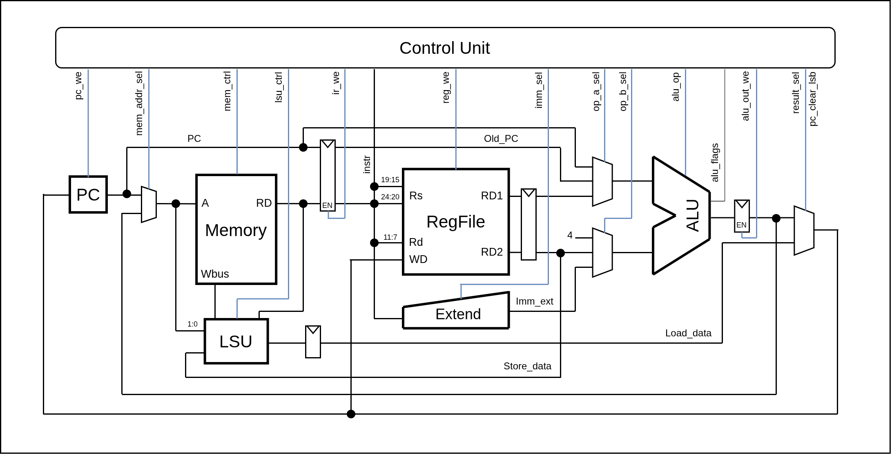

# RISC-V MCU

An educational softcore RISC-V microcontroller for FPGA, written in SystemVerilog.

## Current features

- Multicycle RV32I subset core with memory handshake and byte/halfword/word loads and stores.
- Registered branch decisions and alignment-based memory request gating.
- Machine-mode CSRs: `mstatus`, `mtvec`, `mepc`, `mcause`, `mtval`; six CSR instructions and `MRET`.
- Synchronous exceptions for illegal instructions, misaligned addresses and access faults.
- The CPU core does not support interrupts yet.
- CPU trap-event and instruction-retirement debug outputs.
- 32 KiB synchronous RAM with byte write enables and firmware initialization.
- APB bridge/interconnect with address decoding and unmapped-access errors.
- APB UART with 8N1 TX/RX, independent FIFOs and a polling C driver.
  SoC defaults: 70 MHz, 115200 baud and 32-byte FIFOs per direction.

## CPU datapath

Main datapath; CSR and exception/trap logic omitted.

## Memory map and UART

| Region | Address range (inclusive) | Size |
| --- | --- | --- |
| RAM | `0x00000000`–`0x00007FFF` | 32 KiB |
| APB window | `0x80000000`–`0x8000FFFF` | 64 KiB |
| UART slot | `0x80000000`–`0x80000FFF` | 4 KiB |

The APB window reserves address space, not physical RAM.

| UART register | Offset | Access | Meaning |
| --- | --- | --- | --- |
| TX | `0x00` | Write | Transmit byte in bits `[7:0]` |
| RX | `0x04` | Read | Receive byte in bits `[7:0]` |
| STATUS | `0x08` | Read | Bit 0: TX full; bit 1: RX empty |

## Simulation

Simulation is set up for Questa/ModelSim.

## Firmware platform

Bare-metal startup, a 32 KiB RAM linker script with a 1 KiB stack, UART driver
and machine-mode trap handling with optional `MRET` recovery.

## Acknowledgments

The UART RX hierarchy was inspired by Xilinx XUP "FPGA Design Flow using Vivado"
teaching material. No Xilinx source files are redistributed here; the UART RTL
was rewritten independently in SystemVerilog for educational use.
